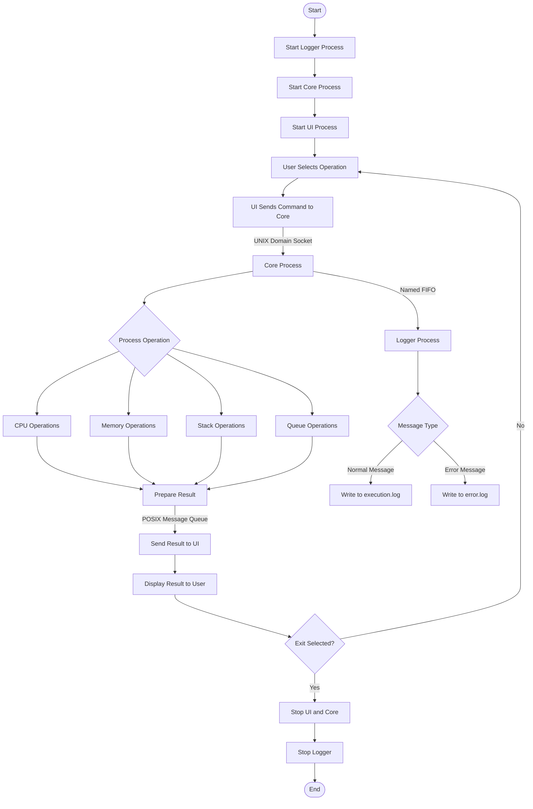

# Week 2 - IPC Flowchart

## Multi-Process Simulator

## IPC Communication Summary

1. **UI to Core:** UNIX domain socket at `/tmp/ipc_core_socket`.
2. **Core to UI:** POSIX message queue named `/core_to_ui`.
3. **Core to Logger:** Named FIFO at `/tmp/ipc_logger_fifo`.

## Execution Order

1. Start Logger.
2. Start Core and wait for the UI connection.
3. Start UI and perform operations.
4. Select Exit to stop the UI and Core.
5. Stop Logger separately.
