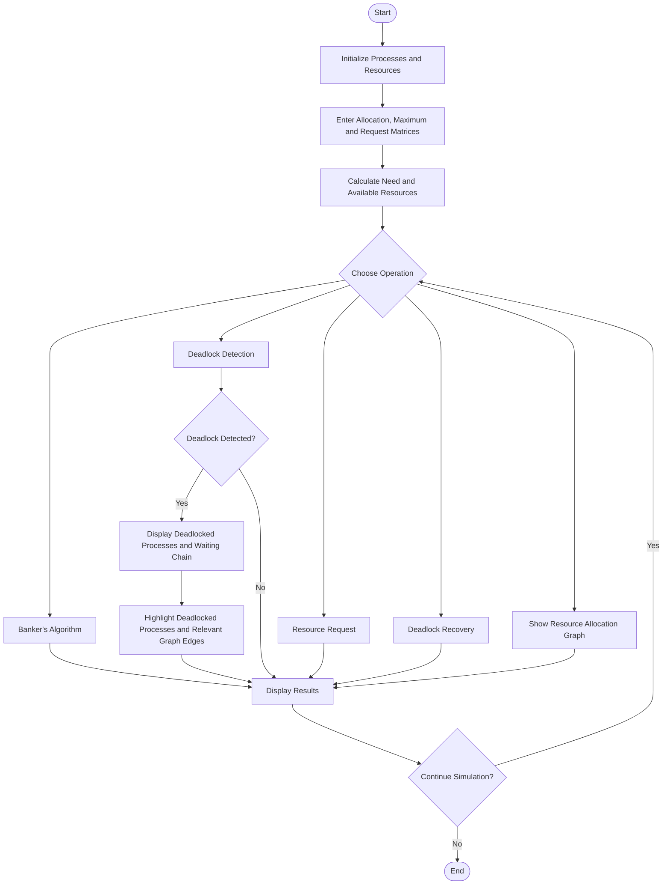

# Deadlock Simulation System

## 1. Flowchart

## 2. Flowchart Explanation

1. **Start:** Begin the Deadlock Simulation System.
2. **Initialize:** Set up the processes and resource types.
3. **Input:** Enter the Allocation Matrix, Maximum Requirement Matrix, resource requests, and total resources as required.
4. **Calculate:** Calculate the Need Matrix and Available Resource Vector.
5. **Choose Operation:** Select Banker's Algorithm, deadlock detection, resource request, recovery, or Resource Allocation Graph display.
6. **Analyze:** Execute the selected operation and determine the system state.
7. **Detect Deadlock:** Check whether processes can finish using the available resources and outstanding requests.
8. **Display Results:** Show the analysis results, safe sequence where applicable, deadlocked processes, and waiting chain when a deadlock is detected.
9. **Update Graph:** If the Resource Allocation Graph has already been displayed, refresh it to highlight deadlocked processes and relevant edges.
10. **Continue or End:** Continue with another operation or end the simulation.
