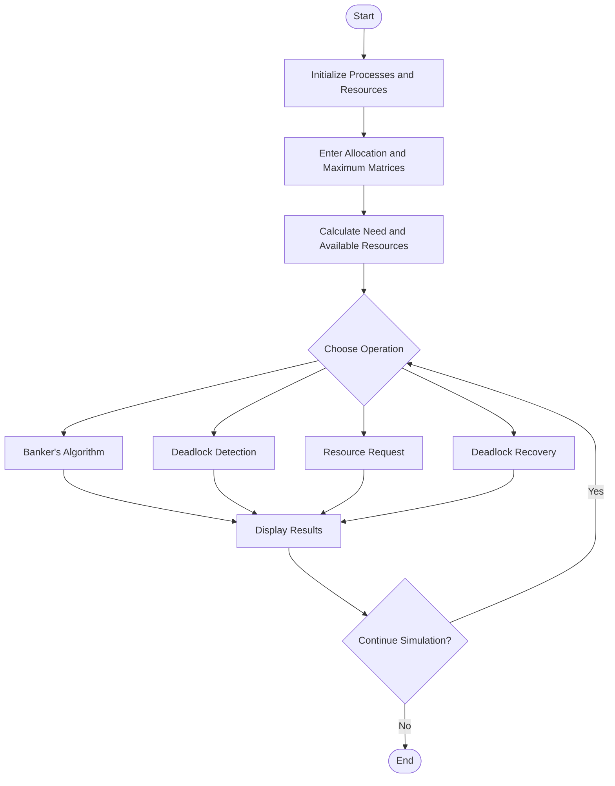

# Deadlock Simulation System

## 1. Flowchart

## 2. Flowchart Explanation

1. Start: Begin the Deadlock Simulation System.
2. Initialize: Set up the processes and resource types.
3. Input: Enter the Allocation Matrix, Maximum Requirement Matrix, and total resources.
4. Calculate: Calculate the Need Matrix and Available Resource Vector.
5. Choose Operation: Select Banker's Algorithm, deadlock detection, resource request, or recovery.
6. Analyze: Execute the selected operation and determine the system state.
7. Display Results: Show the analysis results, safe sequence, deadlocked processes, and Resource Allocation Graph where applicable.
8. Continue or End: Continue with another operation or end the simulation.
